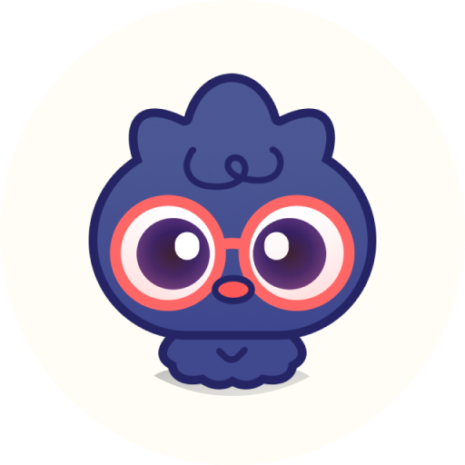

  

  

<h3 align="center">5 questions, 2 minutes — a smarter you every day.</h3>

  
  &nbsp;
  

---

Martie is a friendly crow with big round glasses who quizzes you on the things
worth knowing — science, history, culture, money, health and everyday life.
Answer a few quick questions on your commute or before bed, keep your streak
alive, and learn something new every day.

  
  
  
  

## What you can do

- 📅 **Daily quiz** — Five fresh questions every day. Finish in about two
  minutes and keep your streak.
- 🧠 **20 categories** — Science, world history, law, economy, health, space,
  food, pop culture and more.
- 💬 **Ask Martie** — Curious about an answer? Ask Martie and get the story
  behind it.
- 🏆 **Leagues** — Climb weekly leagues and the Hall of Fame with friendly
  competition.
- 🔁 **Review mistakes** — Missed questions come back later so they stick.
- ✍️ **Create quizzes** — Submit your own question. When others solve it, you
  earn feathers.
- 📖 **Articles** — Short reads that explain the background of popular quiz
  topics.
- 🌏 **9 languages** — Korean, English, Japanese, Traditional Chinese, Spanish,
  French, German, Vietnamese and Thai.

## Get Martie

- **iPhone & iPad** — [App Store](https://apps.apple.com/app/id6740057833)
- **Android** — [Google Play](https://play.google.com/store/apps/details?id=dev.hyo.martie)
- **Web** — play right away at [martie.hyo.dev/app](https://martie.hyo.dev/app/)
  (purchases are available in the iOS and Android apps)

Martie is free to play. Light bulbs 💡 power your quizzes — you earn them
every day, from rewarded ads, or with optional packs. Premium is optional and
adds unlimited bulbs, unlimited quiz chat and an ad-free experience.

## Help and feedback

- In the app, open **My → Send a Letter to Martie** to reach the team.
- Found a bug or have an idea? [Open an issue](https://github.com/hyodotdev/Martie/issues).
- Security problem? Please follow [`SECURITY.md`](./SECURITY.md) instead of
  opening a public issue.

## Built in the open

Martie's full source code lives in this repository, and the project shares its
numbers — revenue, costs and aggregate usage — in
[`OPEN_STARTUP.md`](./OPEN_STARTUP.md). Your account, answers and purchases are
never part of it: open code never means open data.

Want to help? Start with [`CONTRIBUTING.md`](./CONTRIBUTING.md) for the stack,
local setup and pull request guide.

## License

The code is licensed under the
[GNU Affero General Public License v3.0](./LICENSE). The Martie name, logo,
mascot, app icon and store artwork are not covered by that license — see
[`TRADEMARKS.md`](./TRADEMARKS.md).

  
  

